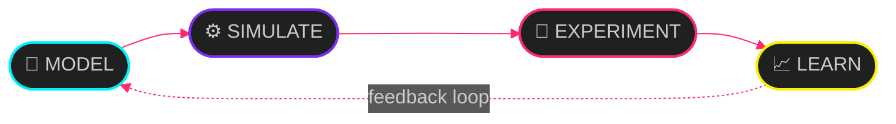

<div align="center">


<a href="https://git.io/typing-svg">
  
</a>

<br/>


</div>


## `> IDENTITY`

```yaml
name:        Siyabonga M. Dlamini
field:       Biomedical Engineering
institution: Cyprus International University
based:       Nicosia, Cyprus
status:      online
```

<details>
<summary><b>⟦ decrypt portrait.ascii ⟧</b></summary>

```
                    ............
                    .......::-----:.....
                 ...:-=++***********+++=-..
               ..-+****************+++*****=..
             ..=##**+++++++**######**++++++**:.
            ..###*+====+++****%%%##*+++==+++++-.
           ..-##*+======+**###%@%%%**++++++++==-.
           ..=**+++++++**#%%%%@@%@@%%%#***+**+==:
            -*#*++++++++***######++=--==++***++=-
            +##++++**++=----==+*=-----=+##***++=-
            -#*=++++++=+----=+#%*+=--=+..:+=--==-
            :#=----=---*+=--=+*#*+++++++***#**+=-=-.
           :=*+++***#####+==+#%%%#*++#%%%%%%%#*+===:
           -=*+**#%%%%%%%*+##*#%%*##+#@@@%%#**+==+
            -*+=+**#%%@@#=++-:-=+====+#%%%%#**+===-
             =+===+*#%%%#**+++*#*++++*###*****+=-.
              .:===+****+++++*###%##*++++++++==--
                -=-====++====+=+*++++*+---======.
                 .=--======++#%%@@@@@%*+========:
                  -=-=====++====++++==-=+++====.
                  =*-----=+********###*#**+=-==
                  :*+=-. .-=+**########*+=:-=**
                    =**+=:.  .:-=+++==:...=+###
                      -**#*+=::.::-----=*#%%%#*.
                        .=####*++===+*%%%%%@%*+:
                           =#%%###*#***##%%%#++-
                             -*%########%%%%*+*=
                               .=***+**##%%#+#*=
                                  .-=*#%%@#*#%+
                                      =@@@###:
```

</details>


## `> RESEARCH_INTERESTS`

| # | Module | Focus |
|:-:|:--|:--|
| `01` | 🧠 **Computational Neuroscience** | Neural computation · brain modelling · network dynamics |
| `02` | ⚡ **Brain-Computer Interfaces** | Neural decoding · signal processing · brain-machine systems |
| `03` | 🤖 **Artificial Intelligence** | Bio-inspired learning · adaptive systems · neural architectures |
| `04` | 🧬 **Biological Systems** | Neuroplasticity · self-organisation · emergent behaviour |
| `05` | 🫀 **Physiological Modelling** | Computational models · simulation · systems biology |
| `06` | 📡 **Biomedical Signal Processing** | Neural signals · biomedical data · computational analysis |


## `> TECH_STACK`

**Languages**


**Machine Learning**


**Scientific Computing**


**Development**


## `> RESEARCH_PHILOSOPHY`

```diff
+ QUESTION   How does biological intelligence emerge?
+ APPROACH   Model → Simulate → Experiment → Learn
+ DIRECTION  Understanding intelligence through computation
- OPEN.TO    Research · Collaboration · Open Source
```




## `> CONNECT`

<div align="center">

[](https://linkedin.com/in/siyabonga-dlamini-82aa41179)
[](https://instagram.com/lugal_siyabonga)

<br/>

> *"If you have enough reasons, you can do the most incredible things."*


</div>
